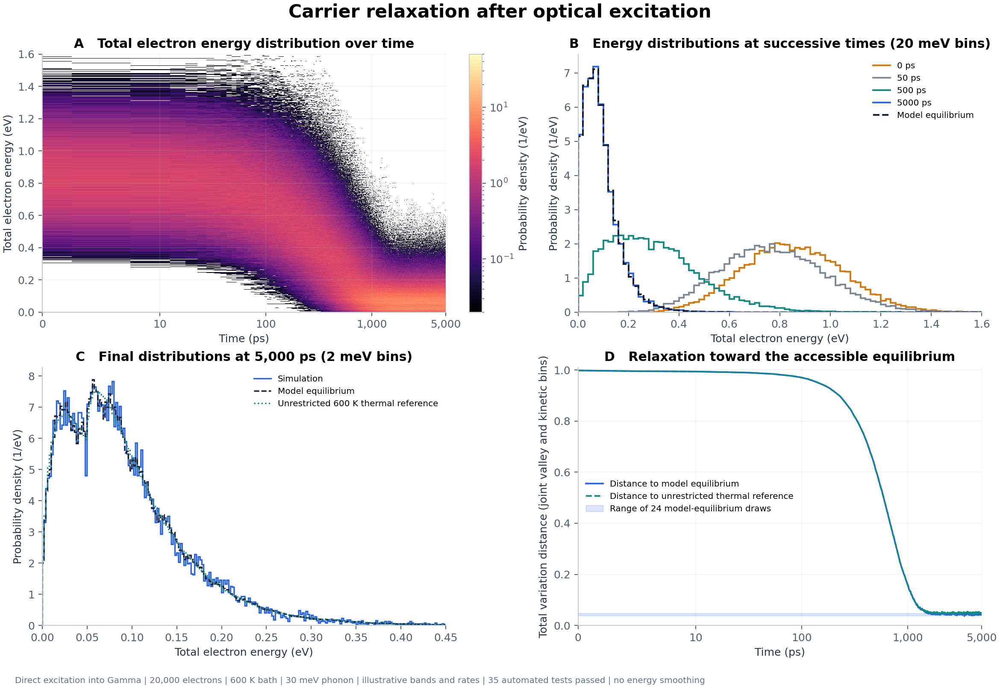

# Monte Carlo carrier scattering

Electron relaxation between parabolic Gamma, X, and L valleys through phonon
emission and absorption. The simulation uses continuous energies and samples
event times from the total scattering rate.

The optical example prepares electrons with a Gaussian laser spectrum weighted
by the valence-to-conduction joint density of states (JDOS). It uses a 1 eV
direct gap, a 2 eV pulse center, and a 1 eV spectral-intensity FWHM. These are
example parameters, not a fit to a material. Electrons evolve in a fixed phonon
bath; holes are recorded at excitation but are not propagated.

## Run

Requires Python 3.10 or later. From the repository root:

```bash
python -m venv .venv
source .venv/bin/activate
python -m pip install -e .
python -m carrier_sim --config examples/optical_excitation_config.json --seed 0 --output results/optical_excitation
```

On Windows PowerShell, activate the environment with
`.venv\Scripts\Activate.ps1`.

The installed `carrier-sim` command and `python examples/run_simulation.py`
accept the same arguments. To shorten the optical run:

```bash
carrier-sim --config examples/optical_excitation_config.json --carriers 2000 --duration-ps 100 --output results/short_run
```

Each run writes:

| File | Contents |
| --- | --- |
| `parameters.json` | Model parameters, seed, and Python/NumPy versions |
| `metrics.json` | Event counts, populations, and conservation errors |
| `arrays.npz` | Energy histograms, population histories, final states, and optical pair energies |
| `summary.png` | Valley distributions, populations, and mean energy |

Reload a saved run with `--config results/optical_excitation/parameters.json`.
The same settings, seed, and software versions reproduce the saved arrays.
`--sample-ps` changes the snapshot spacing, not the event-time calculation.
Use `--show` to display the summary figure.

## Model

For each event, the code balances the valley-floor change, final kinetic
energy, and emitted or absorbed phonon energy. Channels with negative final
kinetic energy have zero rate. Rates use the destination DOS and Bose phonon
occupation; symmetric coupling coefficients give detailed balance.

The [model notes](docs/model.md) define the rates, energy convention, optical
initialization, and equilibrium reference. The example uses a 600 K bath and
one 30 meV phonon mode. It has no electric field, spatial transport,
carrier-carrier scattering, or Pauli blocking.

A single phonon energy preserves each electron's total energy modulo 30 meV.
The equilibrium comparison accounts for those conserved energy classes.
A smooth energy histogram alone is not evidence of unrestricted thermalization.

## Python API

```python
from carrier_sim import OpticalExcitation, SimulationConfig, run_simulation

pulse = OpticalExcitation(band_gap_eV=1.0, photon_center_eV=2.0)
config = SimulationConfig(
    num_carriers=2000, duration_ps=100, optical_excitation=pulse
)
result = run_simulation(config, seed=0)
populations = result.valley_population_history
```

`ScatteringModel` sets the valley floors, masses, degeneracies, temperature,
and coupling matrix. `SimulationResult` contains the time histories and the
per-electron energy balance. Explicit initial-state arrays can also be passed
to `run_simulation` in place of optical excitation.

## Tests and figures

```bash
python -m unittest discover -s tests -v > results/optical_excitation/test_results.txt 2>&1
python examples/plot_optical_comparison.py --run results/optical_excitation --output results/optical_figures
```

Run the simulation first; the plotting command reads its saved arrays and test
log. It writes PNG/SVG figures, equilibrium reference arrays, and numerical
comparisons. Output directories under `results/` are ignored by Git.

The [reference run](docs/validation.md) records 35 passing tests and the
20,000-electron simulation. The [test log](docs/test_results.txt),
[metrics](docs/validation_metrics.json), and
[optical initialization figure](docs/figures/optical_initialization.png) are included.


